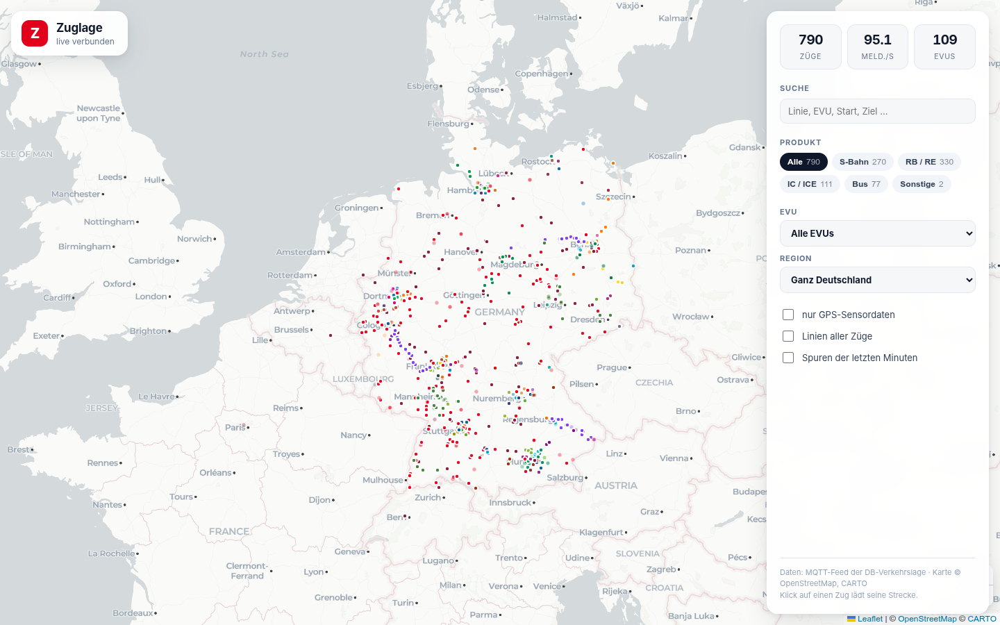

# GPS Train Map (Germany)



Unofficial live map of trains across the German railway network based on GPS data.

## Start

```bash
python3 -m venv .venv
.venv/bin/pip install -r requirements.txt
.venv/bin/uvicorn server:app --host 127.0.0.1 --port 8000
```

Then open <http://127.0.0.1:8000>.

Dump data without server:

```bash
python3 probe/gps_dump.py --duration 60 --out positions.jsonl
```

## Deployment

```bash
./deploy/deploy.sh [ssh-host]   # default: srv1.timschneeberger.me
```

Copies the app to `/opt/ris-map/app`, creates the virtualenv, installs the
systemd unit `ris-map.service` and restarts it. The service listens on
`0.0.0.0:8011`; the unit lives in `deploy/ris-map.service`.
